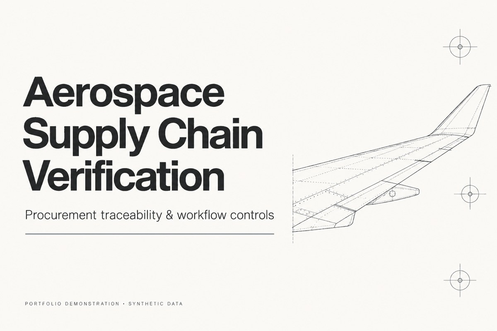
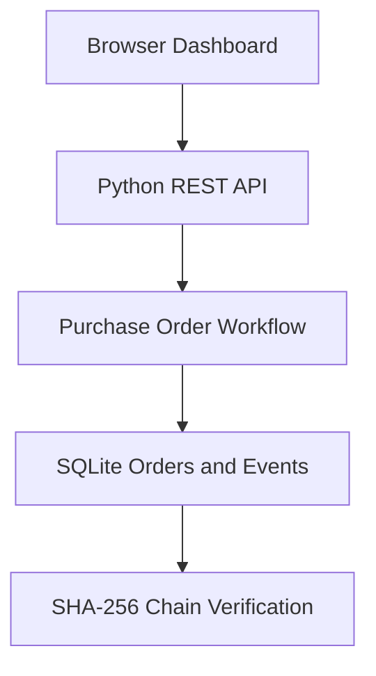

# Aerospace Supply Chain Verification System

## Purchase Order Traceability & Transaction Verification

**A portfolio prototype for traceable aerospace procurement workflows, operational oversight, and tamper detection.**

The Aerospace Supply Chain Verification System tracks purchase orders through approval, delivery, and verification. It combines a browser-based operations dashboard, a Python REST API, SQLite persistence, and a SHA-256 chained event history to demonstrate auditable supply chain processing.

**Portfolio Demonstration · Synthetic Data Only**  
**Version: 1.1 · Portfolio refresh: 27 October 2026**

Legacy scenario label: June 2022; this is not a claim of a verified development date.

## Project documents

- [Business case](Business-Case.md) — why this project, options, beneficiaries and evaluation.
- [Project presentation](docs/Project-Presentation.md) — the complete walkthrough and management use.
- [Workflow and architecture](docs/Workflow-And-Architecture.md) — flowcharts, components and integrity limits.
- [User guide](docs/User-Guide.md) — Windows setup and demonstration walkthrough.
- [Validation record](docs/Validation.md) — checks actually performed.

## Portfolio cover and application evidence



The cover is an editorial illustration. Application screenshots are not included in this release. The optional screenshot capture script is documented in the user guide.

See [validation evidence](docs/Validation.md) and [process diagrams](docs/Workflow-And-Architecture.md).

---

## Business Problem

Aerospace supply chains require reliable traceability across purchasing, supplier coordination, component receipt, and verification. When operational records are fragmented or workflow controls are weak, teams can struggle to identify unauthorized transitions, reconstruct transaction history, and detect altered records.

This prototype provides one controlled workflow for answering four operational questions:

- What is the current status of each purchase order?
- Has every order followed the required sequence of events?
- Who performed each action, and when?
- Has any recorded event been altered after creation?

---

## Delivered Capabilities

- Browser-based operations and audit dashboard
- Purchase order creation with supplier, part, quantity, and unit-cost data
- Controlled workflow from creation through approval, delivery, and verification
- Rejection of invalid or out-of-sequence workflow transitions
- Persistent purchase order and event records stored in SQLite
- REST endpoints for orders, metrics, workflow actions, and audit verification
- SHA-256 event hashes linked to the preceding event
- Tamper detection through complete event-chain recalculation
- Actor and UTC timestamp recording for each workflow event
- Automated tests covering order creation, complete processing, invalid transitions, and modified audit data

---

## Demonstration Baseline

The embedded synthetic scenario creates three aerospace purchase orders when the application is first launched.

| Operational Metric | Demonstration Result |
|---|---:|
| Sample Purchase Orders | 3 |
| Initial Purchase Order Value | CA$25,478.50 |
| Controlled Workflow Stages | 4 |
| Events in a Completed Order History | 4 |
| Automated Test Scenarios | 4 |

The dashboard updates order counts, verified-order counts, and total purchase order value directly from the SQLite database.

---

## Application Workflow



---

## Controlled Status Transitions

| Current Status | Action | Resulting Status |
|---|---|---|
| Created | Approve | Approved |
| Approved | Deliver | Delivered |
| Delivered | Verify | Verified |

Any action attempted outside this sequence is rejected by the workflow engine.

---

## Verification Logic

Each workflow action creates an event containing:

- Purchase order identifier
- Action performed
- Actor
- UTC timestamp
- Previous event hash
- Current SHA-256 event hash

The verification function recalculates every hash and confirms that each event references the correct preceding hash. A changed event value or broken link causes the audit result to fail.

---

## REST API

| Method | Endpoint | Purpose |
|---|---|---|
| GET | `/` | Open the interactive dashboard |
| GET | `/api/orders` | List purchase orders |
| GET | `/api/metrics` | Return aggregate order metrics |
| POST | `/api/orders` | Create a purchase order |
| POST | `/api/orders/{id}/approve` | Approve a created order |
| POST | `/api/orders/{id}/deliver` | Record delivery of an approved order |
| POST | `/api/orders/{id}/verify` | Mark a delivered order as verified |
| GET | `/api/orders/{id}/verify` | Validate the order's event chain |

---

## Quick Start

### 1. Clone the Repository

```powershell
git clone https://github.com/enzosafadi/Aerospace-Supply-Chain-Verification.git
cd Aerospace-Supply-Chain-Verification
```

### 2. Run the Application

The project requires Python 3.9 or later and uses only the Python standard library.

```powershell
python app.py
```

The default port is 8000; a PORT environment variable overrides it.

### 3. Open the Dashboard

Open `http://localhost:8000` in a browser. On first launch, the application creates `demo.sqlite3` and inserts the three sample orders.

---

## Run the Tests

```powershell
python -m unittest -v test_app.py
```

The test suite covers purchase order creation, the complete workflow, invalid transitions, and audit-chain tampering.

---

## Technology Stack

| Component | Purpose |
|---|---|
| Python | Application, API, workflow, and verification logic |
| Python HTTP Server | Local REST service and dashboard hosting |
| SQLite | Purchase order and audit-event persistence |
| HTML, CSS, and JavaScript | Interactive browser dashboard |
| JSON REST API | Front-end and back-end communication |
| SHA-256 | Tamper-evident event-chain hashing |
| unittest | Automated workflow and integrity testing |

---

## Project Structure

```text
aerospace-supply-chain-verification/
├── app.py
├── dashboard.html
├── test_app.py
└── README.md
```

- `app.py` contains the REST API, workflow engine, SQLite operations, and hash-chain verification.
- `dashboard.html` provides the operational dashboard and workflow controls.
- `test_app.py` validates the principal workflow and integrity scenarios.
- `demo.sqlite3` is generated locally when the application runs.

---

## Controls & Limitations

- All suppliers, components, purchase orders, and values are synthetic.
- The SHA-256 chain is stored locally and is not a blockchain.
- Only event fields are hashed; supplier, part, quantity and unit cost are not covered by this event chain.
- Local database access can allow chain rewriting or deletion of trailing events; there is no independent integrity checkpoint.
- Verified is a workflow status, distinct from chain validity and component certification. Actor labels are not authenticated identities.
- The prototype does not connect to SAP, Oracle, SQL Server, Hedera, or another external platform.
- SQLite supports the local demonstration but is not configured as a distributed production database.
- Authentication, authorization, role-based access, and enterprise identity integration are not implemented.
- Production deployment would require hardened validation, concurrency controls, monitoring, security testing, and recovery procedures.

---

## Production Roadmap

1. Add authentication, role-based access, and enterprise identity integration.
2. Connect approved ERP and supplier systems through controlled adapters.
3. Add aerospace quality documentation, compliance checkpoints, and exception workflows.
4. Anchor selected verification proofs to Hedera or another external trust layer.
5. Introduce a production database, monitoring, audit exports, and recovery controls.

---

## Portfolio Context

This repository demonstrates how aerospace procurement events can be organized into a controlled, auditable workflow. It is a functional portfolio prototype and architectural preview, not a deployed customer system or production aerospace platform.

---

**Version 1.1 · Portfolio Demonstration · Synthetic Data**

