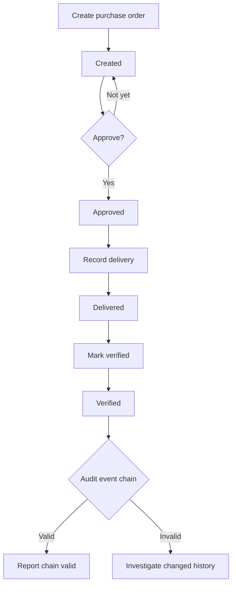
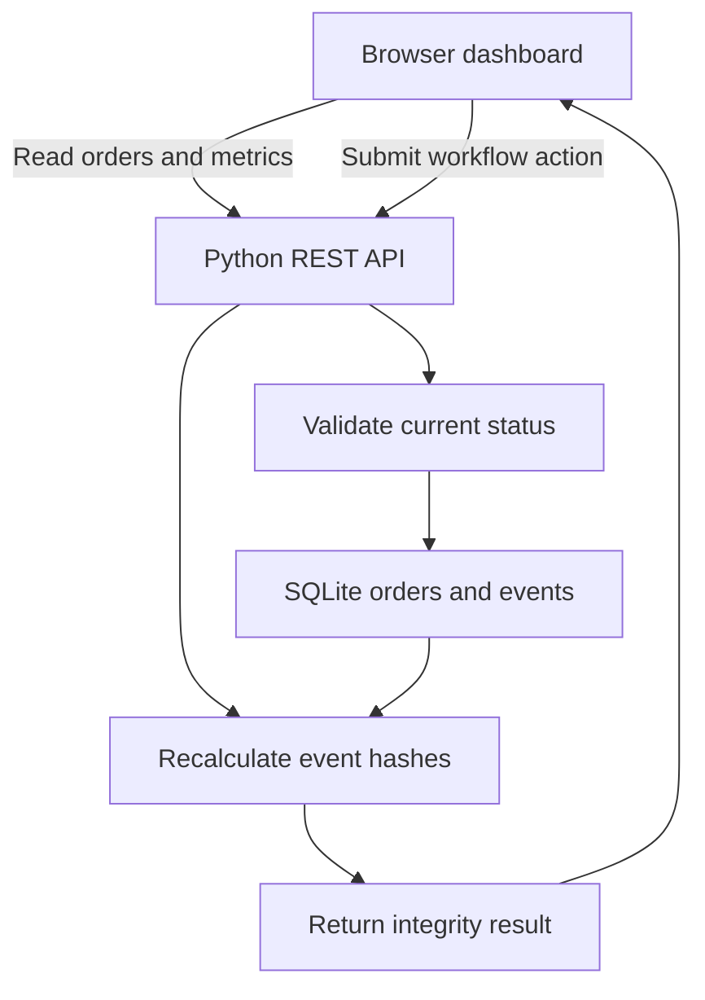
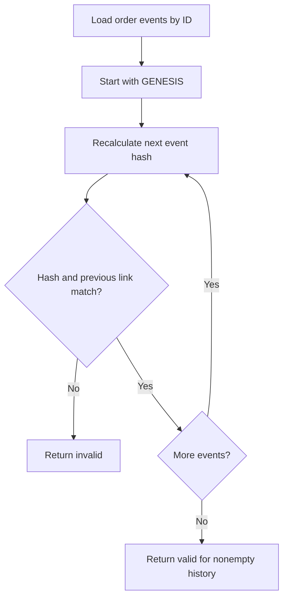

# Aerospace - Workflow and Architecture

## Purchase order decisions

The API rejects transitions that do not match the current state. There is no rejection, cancellation or partial-delivery workflow in this version. Audit failure returns a result; it does not automatically create a case or reverse the order status.

## Application components

## Event integrity check

Hashed fields: order ID, action, actor, timestamp and previous hash. Quantity, part, supplier and unit cost are stored in the order table and are not protected by this event hash. Independent anchoring and detection of deleted suffixes are outside the current design.

## Repository visibility

The existing repository remains public. It contains a small demonstration implementation and synthetic seed data; no private core is needed for the present release. A future proprietary implementation or actual business data would require a private repository and a separately maintained public showcase. This decision does not change visibility on other projects.
